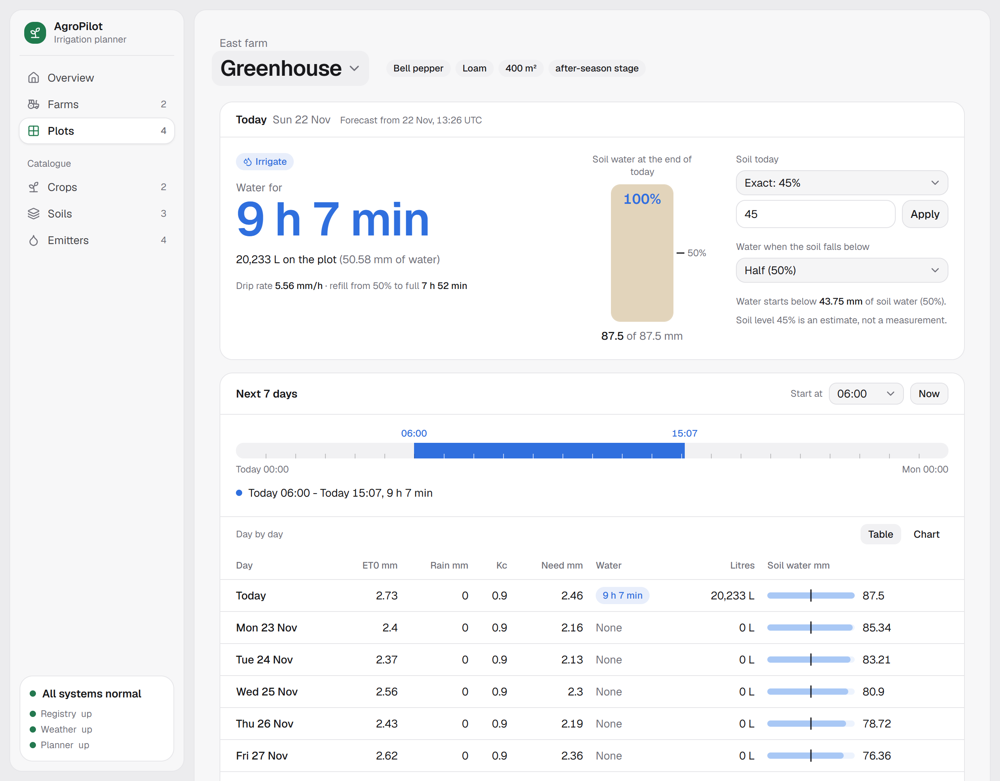
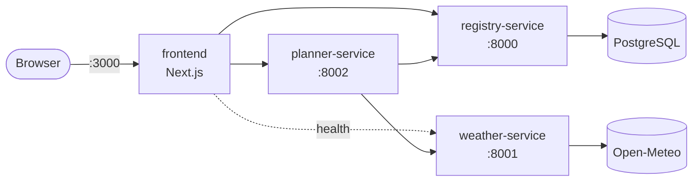

# AgroPilot

**Daily drip-irrigation plans for growers, from the weather forecast and the science of FAO-56.**

AgroPilot answers one question for every plot on a farm: *should I water today, and for how long?* It combines what the grower registered about the plot (crop, planting date, soil, drip system) with a 7-day forecast of evapotranspiration and rain, models the water held in the soil around the roots, and turns the result into a plain answer: **"Water for 38 min"** or **"No irrigation today"**, with the litres and the plan for the week ahead.



## Features

- **Today's answer first.** Each plot page opens with a single recommendation in minutes of drip, then the soil water level, the 7-day watering timeline and the plan as a table or chart.
- **Grounded in FAO-56.** Crop coefficients by growth stage, root depth that grows through the season, a soil water bucket, effective rain, and a 24-hour irrigation cap. Every rule cites its source; five hand-calculated cases are part of the test suite.
- **The grower stays in control.** How wet the soil feels today, when watering should start (half the bucket, the crop's own FAO value, or any level), and the start time of the run are chosen on the page and kept in the address. Nothing is stored in the browser.
- **Honest under failure.** A plan is never built on missing or doubtful numbers. If the weather provider is down, the last forecast (up to 24 hours old) is used and clearly marked stale; past that, the page says which service failed instead of guessing.
- **Whole-farm overview.** The home page lists every farm and plot with today's answer, and how many plots need water today.

## Architecture

Four small services, each with one job. Only the Next.js server talks to the backend services; the browser talks only to the frontend.



| Service | Port | Responsibility | Stack |
| --- | --- | --- | --- |
| [registry-service](services/registry-service/) | 8000 | Farms and plots (CRUD), and the crop, soil and emitter catalogues | FastAPI, SQLAlchemy Core, PostgreSQL (SQLite for local work and tests) |
| [weather-service](services/weather-service/) | 8001 | Daily ET0 and rain for any point, cached per 0.1° grid cell, with retries and a stale fallback | FastAPI, httpx, in-memory cache |
| [planner-service](services/planner-service/) | 8002 | The daily irrigation plan per plot, calculated fresh on every request | FastAPI, httpx, no database |
| [frontend](services/frontend/) | 3000 | The grower's web app: overview, plot page, registry lists | Next.js 16, React 19, Tailwind 4, shadcn/ui |

All three APIs share one error format: RFC 9457 `application/problem+json` with a stable `code` (`VALIDATION`, `NOT_FOUND`, `CONFLICT`, `UNAVAILABLE`, `UPSTREAM_UNAVAILABLE`), and every 503 carries `Retry-After`.

## How a plan is calculated

1. **Season and crop stage** from the plot's planting date give the crop coefficient Kc (tomato and bell pepper, FAO-56 Tables 11 and 12).
2. **The soil bucket** is the soil's available water times the current root depth. Roots grow from 0.2 m at planting to full depth by mid-season.
3. **Each day** the crop uses `Kc x ET0`; rain that counts refills the bucket; anything above full drains away.
4. **Water when the bucket would fall below the trigger**: refill it, up to what the drip system can deliver in 24 hours.
5. **Litres and run minutes** follow from the plot's area, row and emitter spacing, and the emitter's flow.

The full rules with their sources are in the [`irrigation-calc-reference`](.claude/skills/irrigation-calc-reference/SKILL.md) skill; [planner-service](services/planner-service/README.md) documents every field of the answer.

## Getting started

### Prerequisites

- Python 3.12 with [uv](https://docs.astral.sh/uv/)
- Node.js 22 or later
- PostgreSQL (optional: the registry runs on a SQLite file for local work)

### Run the whole stack

Each service reads its settings from a `.env` file (`.env.local` for the frontend); copy the `.env.example` in each service folder once. The stack script expects the registry on PostgreSQL (a `registry` database seeded with `uv run python seed.py`; see the [registry README](services/registry-service/README.md)). From the repository root:

```bash
bash .claude/skills/run-stack/scripts/stack.sh start     # starts all four services in order and waits for each
bash .claude/skills/run-stack/scripts/stack.sh status
bash .claude/skills/run-stack/scripts/stack.sh stop
```

Open <http://localhost:3000>.

### Run services one by one

Without PostgreSQL, run each service in its own terminal with the registry on SQLite:

```bash
# registry-service, with SQLite demo data
cd services/registry-service
uv sync && cp .env.example .env
bash seed_registry.sh
uv run uvicorn main:app --port 8000

# weather-service
cd services/weather-service
uv sync && cp .env.example .env
uv run uvicorn main:app --port 8001

# planner-service
cd services/planner-service
uv sync && cp .env.example .env
uv run uvicorn main:app --port 8002

# frontend
cd services/frontend
npm install && cp .env.example .env.local
npm run dev
```

Every service exposes `GET /health`. The registry and planner serve interactive API docs at `/docs`. Each service README lists its settings, endpoints and failure behaviour.

## Testing

```bash
bash .claude/skills/test/scripts/run-all.sh    # every suite, lint and the frontend build: one PASS/FAIL line each
```

| Suite | Command | Notes |
| --- | --- | --- |
| registry-service | `uv run pytest` | Runs on SQLite by default; set `TEST_DATABASE_URL` to run the same suite on PostgreSQL. Includes a break-the-API matrix: bad values, protocol abuse, broken and locked databases, concurrent writes |
| weather-service | `uv run pytest` | A fake Open-Meteo; never calls the real provider |
| planner-service | `uv run pytest` | Hand-calculated FAO-56 cases, plus fake registry and weather for every failure path |
| frontend | `npm test`, `npm run lint`, `npm run build` | Vitest for `src/lib`, ESLint, and a type-checked production build |

No test calls a real external service.

### Performance

Measured at 10 requests/s, one worker, p95 latency:

| Endpoint | Target | Measured |
| --- | --- | --- |
| registry-service, every GET (PostgreSQL) | 100 ms | 5.8 ms |
| weather-service, cached forecast | 100 ms | 5.7 ms |

Method, scripts and full tables are in each service README.

## Deployment

Production runs on a single AWS EC2 instance (Ubuntu 24.04): one systemd unit per service, all under a dedicated `agropilot` system account, with PostgreSQL on the same host. Only the web app is public; the internal services listen on localhost and the registry API is restricted by IP.

```bash
sudo bash /opt/agropilot/app/deploy/update.sh    # on the instance: pull main, install, build, restart, health-check
```

Setup, operations and lessons from the first deploy are in [deploy/README.md](deploy/README.md).

## Repository layout

```
services/
  registry-service/    farms, plots and catalogues API
  weather-service/     forecast API over Open-Meteo
  planner-service/     FAO-56 irrigation planner
  frontend/            Next.js web app
deploy/                EC2 setup, systemd units, update script
docs/                  QA reports, requirement checks, test plan, judgment log
DECISIONS.md           every design decision and who made it
AGENTS.md              working rules for coding agents in this repo
.claude/skills/        project skills: run, test, QA, deploy, irrigation reference
```

## Project documentation

- [DECISIONS.md](DECISIONS.md): every design decision, grouped by who made it (owner, joint, agent), with the reason. Superseded decisions are marked, not deleted.
- [docs/judgment-log.md](docs/judgment-log.md): where the agent's recommendation and the owner's choice differed, and why.
- [docs/test-plan.md](docs/test-plan.md): the whole-system test plan.
- [docs/qa/](docs/qa/): QA reports, local and on the live deployment.
- [docs/extras.md](docs/extras.md): everything built beyond the task requirements.

## About this project

AgroPilot is built as the course project for [OzVeruach26](https://github.com/alonitac/OzVeruach26), in stages: P1 delivered the registry API, P2 added PostgreSQL, the weather and planner services, the frontend and the AWS deployment. It is developed with an AI coding agent under a simple rule: the owner decides, the agent builds and supplies the information to decide well. [AGENTS.md](AGENTS.md) holds the working rules.

## Acknowledgements

- Irrigation method: Allen et al., *Crop evapotranspiration - Guidelines for computing crop water requirements*, [FAO Irrigation and Drainage Paper 56](https://www.fao.org/3/x0490E/x0490e00.htm) (1998).
- Weather data: [Open-Meteo](https://open-meteo.com/).

## License

Copyright (c) 2026 Tomer Karmazin. All rights reserved.
