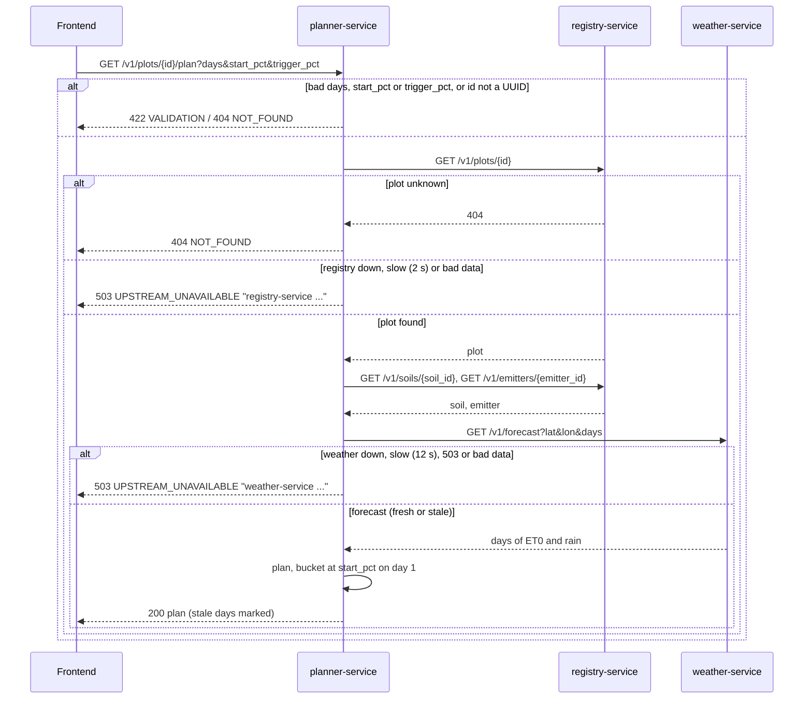

# Planner service

The daily drip-irrigation plan for AgroPilot. For one plot it answers, day by day from today: how much water the crop needs, how full the soil is, and whether to water today, in **litres** and **minutes** of drip. It asks `registry-service` for the plot, its soil and its emitter, asks `weather-service` for the forecast at the plot's point, and calculates the plan with FAO-56 (single crop coefficient, soil water bucket). It has no database and no cache: every request calculates a fresh plan.

Every error is RFC 9457 `application/problem+json` with a `code`: `VALIDATION` (422), `NOT_FOUND` (404), `UPSTREAM_UNAVAILABLE` or `UNAVAILABLE` (503, always with `Retry-After: 5`). A 405 has no `code`, like in the other services.

## Run it

Run these from this folder. You need [uv](https://docs.astral.sh/uv/), and `registry-service` (port 8000) and `weather-service` (port 8001) running for real plans.

```bash
uv sync                                   # create .venv with the dependencies
cp .env.example .env                      # the settings file; .env is never committed
uv run uvicorn main:app --port 8002
```

- API: `http://127.0.0.1:8002/v1/plots/{id}/plan`
- Health check: `/health`
- API docs: `/docs` (on, for the frontend; Y13)

**Settings.** All of them are required and live in `.env` (the environment wins). If one is missing or out of range, the service stops at startup with one line naming it, for example `Missing or invalid setting: WEATHER_URL. Copy .env.example to .env and fill it in.`

| Variable | Example | Meaning |
| --- | --- | --- |
| `REGISTRY_URL` | `http://127.0.0.1:8000` | Where `registry-service` answers |
| `WEATHER_URL` | `http://127.0.0.1:8001` | Where `weather-service` answers |
| `REGISTRY_TIMEOUT_SECONDS` | `2` | Wait this long for each registry answer (at most 60) |
| `WEATHER_TIMEOUT_SECONDS` | `12` | Wait this long for the forecast (at most 60). Longer than weather-service's own worst case (about 10 s), so its stale answer still arrives (O84) |

## Endpoint

`GET /v1/plots/{id}/plan?days={days}&start_pct={start_pct}&trigger_pct={trigger_pct}`

- `id` is the plot's id in the registry. Any UUID spelling works; the answer uses lowercase.
- `days` is a whole number from 1 to 7, default 7. Day 1 is today at the plot (the forecast's first day).
- `start_pct` is a number from 0 to 100, decimals allowed, default 100: how full the soil bucket is at the start of today. 100 is full (field capacity), 0 is empty (wilting point). Below the trigger the plan irrigates on day 1. The answer repeats the value used.
- `trigger_pct` is a number from 1 to 99, decimals allowed, default 50: a day irrigates when the bucket would end it below this percent of TAW. The crop's own value (FAO Table 22, `(1 - p) x 100`) is returned as `crop_trigger_pct`: tomato 60, bell pepper 70. FAO's range for p is 0.30-0.70, so 30-70 is the usual range; the planner accepts any value from 1 to 99 and the frontend warns outside 30-70.

`GET /v1/plots/c8f3d1b0-4d2e-5a1b-8b22-1d6e3f702002/plan?days=3` (North block, real answer of 2026-11-16):

```json
{
  "plot_id": "c8f3d1b0-4d2e-5a1b-8b22-1d6e3f702002",
  "crop_id": "tomato",
  "soil_id": "loam",
  "start_pct": 100.0,
  "trigger_pct": 50.0,
  "crop_trigger_pct": 60.0,
  "drip_mm_per_hour": 1.67,
  "forecast_fetched_at": "2026-11-16T17:35:55Z",
  "days": [
    {
      "date": "2026-11-16", "et0_mm": 2.76, "rain_mm": 0.0, "kc": 0.8, "stage": "after-season",
      "need_mm": 2.21, "irrigation_mm": 0.0, "capped": false, "litres": 0.0, "run_minutes": 0,
      "bucket_capacity_mm": 122.5, "trigger_mm": 61.25, "bucket_end_mm": 120.29, "stale": false
    },
    {
      "date": "2026-11-17", "et0_mm": 2.63, "rain_mm": 0.0, "kc": 0.8, "stage": "after-season",
      "need_mm": 2.1, "irrigation_mm": 0.0, "capped": false, "litres": 0.0, "run_minutes": 0,
      "bucket_capacity_mm": 122.5, "trigger_mm": 61.25, "bucket_end_mm": 118.19, "stale": false
    },
    {
      "date": "2026-11-18", "et0_mm": 2.54, "rain_mm": 0.0, "kc": 0.8, "stage": "after-season",
      "need_mm": 2.03, "irrigation_mm": 0.0, "capped": false, "litres": 0.0, "run_minutes": 0,
      "bucket_capacity_mm": 122.5, "trigger_mm": 61.25, "bucket_end_mm": 116.16, "stale": false
    }
  ]
}
```

| Field | Meaning |
| --- | --- |
| `start_pct` | The bucket level day 1 started from, in percent (the request's value, 100 when none was given) |
| `trigger_pct` | The trigger used, in percent of TAW (the request's value, 50 when none was given) |
| `crop_trigger_pct` | The crop's own trigger from FAO Table 22 (tomato 60, bell pepper 70) |
| `drip_mm_per_hour` | What the plot's drip system gives per hour: `flow_lph / (row_spacing_m x emitter_spacing_m)` |
| `forecast_fetched_at` | When weather-service got this forecast from its provider (UTC) |
| `date` | The day (the plot's local date) |
| `et0_mm` | ET0 from the forecast: water a standard grass field loses that day |
| `rain_mm` | The rain that **counts**: the forecast rain, or 0 when it is below 0.2 x ET0 (it just evaporates) |
| `kc` | Crop coefficient for that day of the season |
| `stage` | `initial`, `development`, `mid`, `late`, or `after-season` (the season is over; the plan goes on with the end Kc) |
| `need_mm` | The crop's water need, `kc x et0_mm` |
| `irrigation_mm` | Water to give that day; 0 on most days. At most what the drip system gives in 24 hours (`drip_mm_per_hour x 24`) |
| `capped` | `true` when the bucket needed more than that: the day runs exactly 1440 minutes and the bucket ends below full. The next day the trigger decides again |
| `litres` | `irrigation_mm` over the plot's area (1 mm on 1 m² is 1 litre) |
| `run_minutes` | How long to run the drip system, rounded up; 0 on a day with no irrigation |
| `bucket_capacity_mm` | How much water the soil around the roots holds when full. It grows with the roots |
| `trigger_mm` | `trigger_pct` of it: the plan waters when the bucket would end the day below this |
| `bucket_end_mm` | Water in the bucket at the end of the day |
| `stale` | `true` when weather-service could not reach its provider and served its last forecast (FR-2.13) |

Numbers are rounded only in the answer, half up: `kc` to 3 decimals, mm to 2, `litres` to 1 (A60).

## How the plan is calculated

The rules, with their FAO-56 sources, are in the `irrigation-calc-reference` skill (`.claude/skills/irrigation-calc-reference/SKILL.md`), and `engine.py` follows them step by step. In short:

1. **Day of the season** from the plot's `planting_date`, then the **stage and Kc** of the crop for that day (tomato and bell pepper, FAO Tables 11 and 12; the crop table lives in the planner, O54).
2. **The bucket**: the soil's `available_water_mm_per_m` times the root depth. Roots grow from 0.2 m at planting to full depth (tomato 0.7 m, pepper 0.5 m) by mid-season (O77).
3. **Every day**: the crop takes `need_mm`, counted rain fills the bucket back, and water above full drains away.
4. **Water when below the trigger**: if the bucket would end the day below `trigger_pct` of TAW (default 50, half), water today to refill it (O78, O79), but no more than the drip system gives in 24 hours. A capped day leaves the bucket below full and nothing is carried over: the next day the trigger decides again.
5. **Litres and minutes**: from the plot's area, row and emitter spacing and the emitter's flow (O82).

The plan starts with the bucket at `start_pct` percent (default 100, full): the planner keeps no history and has no soil sensor, so the grower says how wet the soil is today. The starting depletion is TAW of day 1 x (1 - start_pct / 100). With the default, a plot is watered only once the forecast days would take it below the trigger.

**Checked by hand.** Five cases calculated by hand (`references/cases.md` in the skill) are tests: the engine matches them, and case 3 (North block on 2026-11-16) also goes through the whole API with fake services.

## Failures

The planner never answers with a plan built on missing or doubtful numbers (FR-2.14). Every answer from the other services is checked before it is used: exact JSON types, no NaN or Infinity, area, spacings, soil water and flow above 0, ET0 and rain 0 or more, and exactly the days asked for (A61).

| Situation | Answer |
| --- | --- |
| `days` not 1 to 7, `start_pct` not a number from 0 to 100 or `trigger_pct` not a number from 1 to 99 (`nan` and `inf` too), or an unknown query parameter | `422 VALIDATION`, no other service is asked |
| The id is not a UUID | `404 NOT_FOUND`, the registry is not asked |
| The registry has no such plot | `404 NOT_FOUND` |
| Registry or weather down, too slow, an error status, or data that fails the checks | `503 UPSTREAM_UNAVAILABLE`, `detail` names the service, for example `weather-service is not reachable` |
| The plot's soil or emitter is missing in the registry | `503 UPSTREAM_UNAVAILABLE` (the registry's data is broken, not the request) |
| The planner has no data for the plot's crop | `503 UNAVAILABLE` |
| The forecast is stale | `200`, every day `stale: true` |

### Flow



## Test it

```bash
uv run pytest          # 130 passed, about 1 s
```

Tests need no `.env` and never call a real service. `tests/test_engine.py` checks the calculation against the five hand-calculated cases and the edges of every rule. `tests/test_plan.py` replaces the registry and weather with fakes (`httpx.MockTransport`) and checks the plan through the API, the calls made, and every kind of failure.

## More

- Decisions: `DECISIONS.md` O76-O86, A60-A61.
- FAO-56 research note: `docs/research/fao56.md`.
- FAO-56: <https://www.fao.org/3/x0490E/x0490e00.htm>
