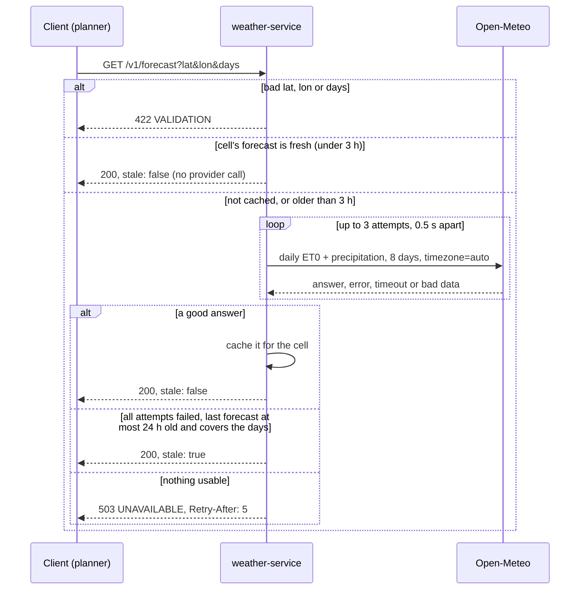

# Weather service

The daily weather for AgroPilot. For any point on Earth it serves, day by day, **ET0** (how much water a standard patch of grass loses to sun and wind, in mm) and **rain** (mm), starting today. The numbers come from [Open-Meteo](https://open-meteo.com/en/docs) (**the provider**), and are cached in memory per 0.1° grid cell. The service knows coordinates and dates only, nothing about farms, plots or crops.

Every error is RFC 9457 `application/problem+json` with a `code`: `VALIDATION` (422), `NOT_FOUND` (404) or `UNAVAILABLE` (503, always with `Retry-After: 5`). A 405 has no `code`, like in the registry.

## Run it

Run these from this folder. You need [uv](https://docs.astral.sh/uv/).

```bash
uv sync                                   # create .venv with the dependencies
cp .env.example .env                      # the settings file; .env is never committed
uv run uvicorn main:app --port 8001
```

- API: `http://127.0.0.1:8001/v1/forecast?...`
- Health check: `/health`

**Settings.** All of them are required and live in `.env` (the environment wins). If one is missing or out of range, the service stops at startup with one line naming it, for example `Missing or invalid setting: FRESH_HOURS. Copy .env.example to .env and fill it in.`

| Variable | Example | Meaning |
| --- | --- | --- |
| `PROVIDER_BASE_URL` | `https://api.open-meteo.com/v1/forecast` | The provider's forecast URL |
| `PROVIDER_API_KEY` | *(empty)* | Sent as `apikey` only when set. The free tier needs none; a paid plan or another provider is a config change |
| `PROVIDER_TIMEOUT_SECONDS` | `3` | One attempt gives up after this long |
| `PROVIDER_RETRIES` | `2` | Extra attempts after the first one fails |
| `PROVIDER_RETRY_PAUSE_SECONDS` | `0.5` | Pause between attempts |
| `FRESH_HOURS` | `3` | A forecast this young is served without calling the provider |
| `MAX_STALE_HOURS` | `24` | When the provider fails, a forecast up to this old is served with `stale: true` |

## Endpoint

`GET /v1/forecast?lat={lat}&lon={lon}&days={days}`, all three required:

- `lat` from -90 to 90, `lon` from -180 to 180, `days` a whole number from 1 to 7. Anything else (also NaN, Infinity, a missing or unknown parameter) is `422 VALIDATION`.
- The answer has `days` days, starting today **at the point** (its own time zone). `lat` and `lon` are echoed as sent.

`GET /v1/forecast?lat=31.25&lon=34.79&days=3` (real answer):

```json
{
  "lat": 31.25,
  "lon": 34.79,
  "source": "open-meteo",
  "fetched_at": "2026-11-16T11:17:14Z",
  "stale": false,
  "days": [
    { "date": "2026-11-16", "et0_mm": 2.77, "rain_mm": 0.0 },
    { "date": "2026-11-17", "et0_mm": 2.62, "rain_mm": 0.0 },
    { "date": "2026-11-18", "et0_mm": 2.47, "rain_mm": 0.0 }
  ]
}
```

`fetched_at` is when the provider gave this forecast (UTC). `stale: true` means the provider is failing right now, and this is the last forecast we got for this cell.

## Where the numbers come from

One call per grid cell to Open-Meteo's `/v1/forecast`, asking for two daily variables (the names never leave `provider.py`):

| Our field | Open-Meteo daily variable | Unit | What it is |
| --- | --- | --- | --- |
| `et0_mm` | `et0_fao_evapotranspiration` | mm | Daily sum of FAO-56 reference evapotranspiration (ET0) of a well-watered grass field |
| `rain_mm` | `precipitation_sum` | mm | Daily sum of all precipitation: rain, showers and snowfall (O69) |

- **Why `precipitation_sum` and not `rain_sum`:** `rain_sum` leaves out showers. On 16 November 2026 the demo point had 0.3 mm of precipitation on one day but 0.0 mm of `rain_sum`. All of it reaches the soil, and counting too little rain means watering too much.
- **Other parameters:** `timezone=auto`, so days follow the point's local date (O70), and `forecast_days=8` (see below).
- **Units are checked** in every answer. If either field is not `mm`, the answer is refused.

## Cache and failures

- **Grid cell (FR-2.5, O71).** A point is rounded down to 0.1°: 31.25 and 31.29 are both in cell 31.2-31.3. The provider is asked once per cell, at the cell's center (31.25). lat 90 and lon 180 join the cell below, so the center is always a real point. The cache keeps the whole forecast; `days` only cuts it.
- **Fresh for 3 hours.** While a cell's forecast is younger than `FRESH_HOURS`, the provider is not called.
- **Retries (FR-2.6, O73).** A failed call is tried again `PROVIDER_RETRIES` times, `PROVIDER_RETRY_PAUSE_SECONDS` apart. A call fails on a timeout, a connection error, any non-2xx status, a body that isn't JSON, a missing field, a value that is `null`, text, `true`, negative, NaN or Infinity, a unit other than `mm`, or dates that aren't 8 consecutive days (O74, A58). With the example settings the worst case is 3 × 3 s + 2 × 0.5 s = 10 s.
- **Never a made-up number (FR-2.8).** A failed answer is never cached, and no gap is ever filled with zeros or defaults.
- **One call at a time per cell.** Ten requests that miss the cache for one cell at the same moment make one provider call; the others wait for it. Other cells don't wait.
- **No database.** The cache lives in the process's memory. A restart empties it, and the next request fetches again.

### How old a stale forecast may be: 24 hours

When the provider fails, the last forecast is served with `stale: true` only if it was fetched **at most 24 hours ago** (`MAX_STALE_HOURS`, O72). After that: `503 UNAVAILABLE`.

- **Why 24 hours:** a forecast is a guess about the next days. A day-old one is still a reasonable basis for today's watering. An older one has drifted too far to water by.
- **Why 8 days are fetched:** a stale answer still starts **today**. Days that have passed are dropped. With 8 days fetched, a forecast up to 24 hours old still covers 7 days from today.
- **If too few days are left** for the `days` asked: `503`, never a missing day filled in.

### Flow



## Test it

```bash
uv run pytest          # 75 passed, about 1 s
```

`uv run pytest --cov` checks 100% line and branch coverage.

`uv audit --locked --preview-features audit-command` checks `uv.lock` for known vulnerabilities (O149).

Tests need no `.env` and never call the real provider. `tests/test_provider.py` replaces the network with a fake Open-Meteo (`httpx.MockTransport`) and checks every kind of bad answer. `tests/test_forecast.py` replaces the clock and the provider call, to check fresh, stale, 24 hours, 503, grid cells and ten requests at once.

## Latency (NFR-2.3: fresh forecast, p95 ≤ 100 ms at 10 req/s)

Method: three points in three cells were asked once (not counted) to fill the cache. Then requests went out at 10 req/s for 60 s, cycling through the three points, on a fixed schedule that doesn't wait for earlier answers. The script checks that `fetched_at` never changed, which proves that no measured request called the provider. Script: `scripts/measure_latency.py`.

| Requests | Errors | p50 | **p95** | p99 | max |
| --- | --- | --- | --- | --- | --- |
| 600 | 0 | 3.7 ms | **5.7 ms** | 6.7 ms | 14.6 ms |

With the provider unreachable (connection refused) and nothing cached, the answer was 503 with `Retry-After: 5` after 1.0 s: 3 attempts and two 0.5 s pauses.

Test machine: i7-1165G7 laptop, WSL2, Python 3.12, one uvicorn worker, client on the same machine.

## More

- Decisions: `DECISIONS.md` O68-O75, A58-A59.
- The provider's docs: <https://open-meteo.com/en/docs>
